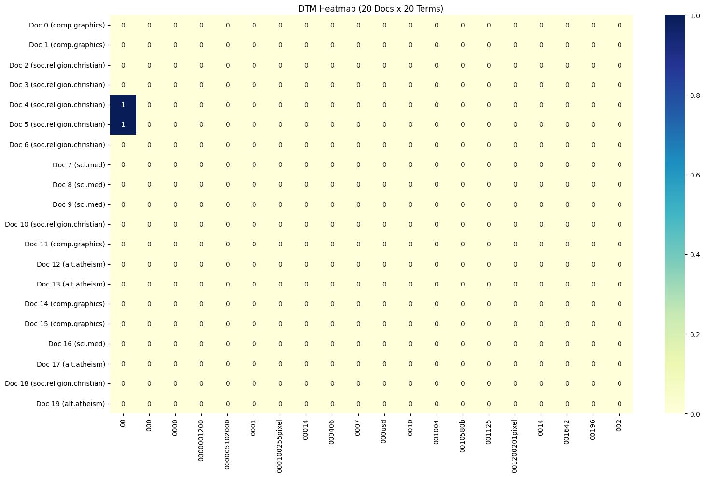
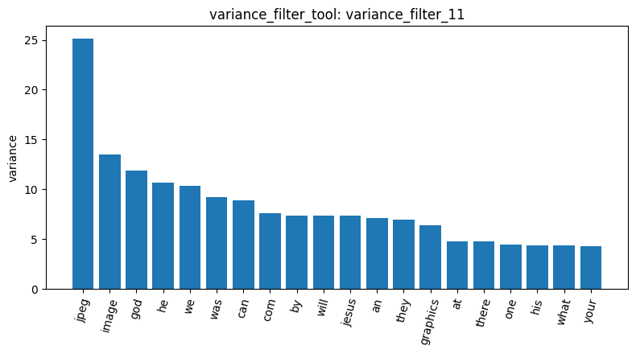
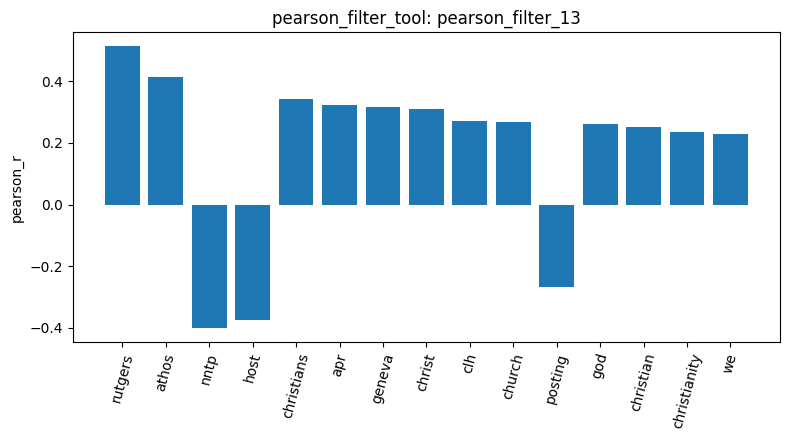
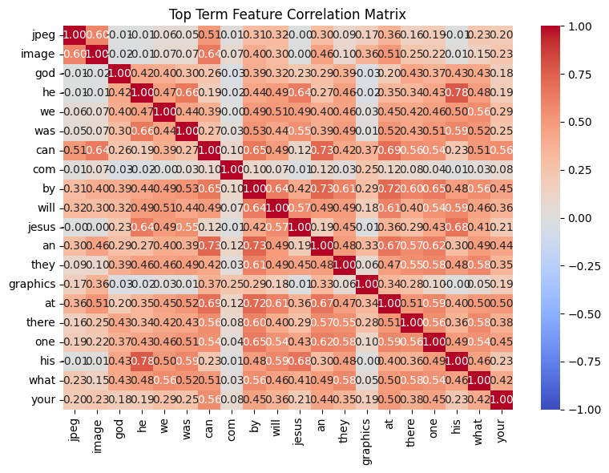
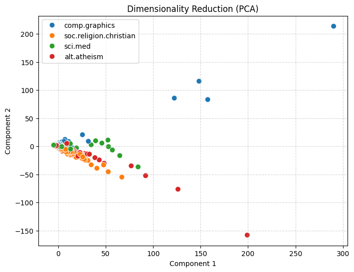
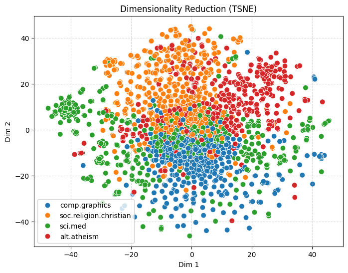
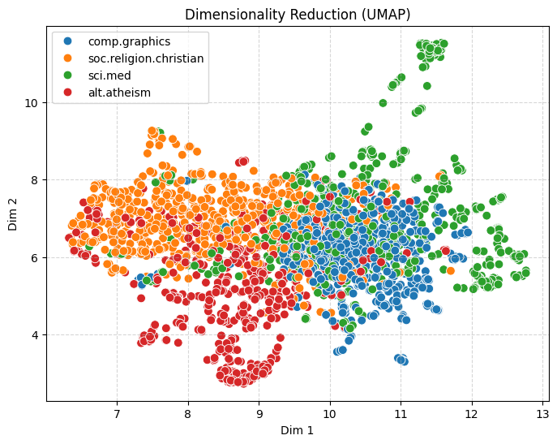

# Agentic Pipeline Report — 20 Newsgroups (4 categories)

I directed the agent through the pipeline on the training split of 20 Newsgroups restricted to four categories (`load_dataset_1`): **2,257 posts** — soc.religion.christian 599, sci.med 594, comp.graphics 584, alt.atheism 480. Before approving tool access, I tested whether the agent would request and grant access in the same step (it refused, as it should), then approved deliberately, noting that the grant also covers tools that modify the data and asking to be consulted before any such change.

*Note on result ids:* the notebook kernel was restarted after `mine_patterns_20`, so the id counter restarted at 1. Ids in §5–§6 are marked **(after restart)**. After the restart I rebuilt the matrix with the same settings as `dtm_9` and confirmed the same shape (2,257 × 18,466, `dtm_2`), so all results refer to the same matrix.

## 1. Data quality: the headers are still in the text

The first rows (`inspect_2`) showed that every post is a raw Usenet message that still begins with its e-mail header (`From:`, `Subject:`, `Organization:`, `Lines:`, sometimes `Nntp-Posting-Host:`), and replies contain quoted text. Since `build_dtm_tool` vectorizes the full text, I predicted that header words would enter the vocabulary and might correlate with categories for reasons unrelated to topic. This prediction became the thread that runs through the rest of the analysis.

There were no missing texts (`missing_3`) and no duplicates (`duplicates_4`, report only). Text lengths (`describe_5`) are strongly right-skewed in every category. comp.graphics stood out: it has the lowest median length (883 characters) and also the longest post in the dataset (60,713). I asked the agent why; it suggested (unverified) that most graphics posts are short questions while a few are very long code or file dumps. I kept this in mind because, with raw counts, a few huge documents can dominate later statistics.

## 2. Document-term matrix: rebuilding it after looking at it

The baseline matrix with Master's settings (`dtm_6`) was 2,257 × 35,788 with 99.547% sparsity. Two things looked wrong. The most frequent terms (`term_freq_7`) were all function words (`the` 29,825, `of`, `to`, …) plus two header words, `from` and `edu`. A slice of the matrix (`dtm_heatmap_8`) had only 2 non-zero cells out of 400, and its first vocabulary entries were junk tokens such as `000100255pixel` and `0010580b`.

So I rebuilt the matrix with `min_df=2` (drop one-off tokens) and `max_df=0.5` (drop words in more than half of the posts). I chose 0.5 because the largest category holds only about a quarter of the posts, so a topic-specific word cannot reach 50% and is safe. The result, `dtm_9`, is 2,257 × 18,466 (sparsity 99.2756%) and is used for everything after this point. The top terms (`term_freq_10`) were still mostly function words (`was`, `can`, `we`, …). `god` (11th) was the first topical word, and the header suffix `com` also survived. Lowering `max_df` further would also have removed words like `god`, which appear in both religion groups. I concluded that frequency measures how *common* a word is, not how *informative* it is, and that the label-based filters were the right next step.

## 3. Feature filtering: finding topic words, and finding the leakage

**Variance (`variance_filter_11`).** I set the threshold to 0.01, reasoning that for a word occurring once per document this means roughly "in fewer than ~1% of posts". 13,369 terms were flagged as low-variance and 5,097 were kept. The bar chart showed one oddity: `jpeg` has a variance of about 25, nearly twice the next term (`image`, about 13.5), even though it is not among the 20 most frequent words. A low total with a very high variance means its count is concentrated in a few posts. This fits the very long comp.graphics posts from §1, so variance rewards *bursty* words as well as frequent function words, and it cannot tell either from a topic word.

**Pearson, comp.graphics (`pearson_filter_12`).** The top terms mixed real topic words (`vga`, `video`, `card`, `algorithm`, `graphics`) with a help-request style (`thanks` is the strongest at r = 0.2778; `looking`, `hi`). The style words support the agent's earlier "short questions" hypothesis. The list also contained header words: `keywords`, `host` and `nntp`. All |r| were modest, but every p-value was tiny; with 2,257 documents even weak correlations are significant.

**Pearson, soc.religion.christian (`pearson_filter_13`).** Before running it I made two predictions: `rutgers`, which was negative for graphics, would be strongly positive here, and `god` would rank lower than expected because alt.atheism also uses it. Both held. `rutgers` was first (r = 0.5133) and `god` only 12th (r = 0.2622). The bigger finding was that 7 of the top 10 terms are metadata: `rutgers`, `athos`, `geneva`, `clh`, `apr`, and `nntp`/`host` (r = −0.3993 / −0.3753). The same `Nntp-Posting-Host` header was *positive* for graphics and *negative* for christian, so the filter treats how a post was routed as a category signal: this is **metadata leakage**. I also noticed that the agent's first listing had only 14 terms. When I asked again, `christ` (r = 0.3106) appeared at rank 8. I plotted the stored result with `visualize_result_tool` to check the order independently of the agent's text.

**Spearman (`spearman_filter_14`).** I expected a rank correlation to keep the leakage but to treat topic words better. Both happened. `rutgers` stayed first (ρ = 0.5498) and 8 of the top 15 terms were still metadata, but `god` rose from 12th to 2nd (ρ = 0.4876), and `jesus` and `faith` entered the list. A plausible reason is that Spearman mainly reflects *whether* a word occurs, while Pearson is pulled down by long posts in other groups that repeat a word many times. One caveat: this tool scores only the 1,500 highest-variance terms, so terms missing from its list may have been filtered out before scoring rather than ranked lower.

**Feature correlation (`feature_corr_15`).** Among the 20 highest-variance terms, the strongest pairs were all function words (`he–his` 0.7788, `by–an` 0.7333), and almost every cell was positive. I read this as a document-length effect: a long post has high counts of every common word at once. `com` served as a control. It comes from the e-mail address, occurs about once per post, and correlates with almost nothing. The agent's first top-5 list had misaligned values, so I checked them against the heatmap. Topical pairs were weaker: `jpeg–image` 0.5998 and `god–jesus` only 0.2259, consistent with `god` being shared with alt.atheism.

## 4. Pattern mining: headers again, from a different angle

`mine_patterns_tool` builds its own per-category matrix with English stop words removed, so I hoped it would surface topic words. My first run on soc.religion.christian with the `term_frequency` filter (`mine_patterns_16`) was degenerate: only single words with support 25–28 (e.g. `andy`, `aisun3`, `jeesus`). This filter drops the 5% most frequent terms, which removed exactly the words that characterise the category. So I switched to the `tfidf` filter (`mine_patterns_17`). Now header keywords filled the list: `lines`/`subject` in all 599 posts, `organization` 536, `edu` 465. The only topic word was `god` (344 posts, 57%). Stop-word removal fixed the function words but did nothing about the headers.

I ran the same settings on comp.graphics (`mine_patterns_18`) to compare. Again only header words appeared, but in different proportions: `edu` was in 78% of christian posts and 55% of graphics posts, and the `Nntp-Posting-Host` words (`posting` 288, {host, lines} 276) were frequent in graphics but absent from the christian top 20. These differences in header frequency between groups are exactly what the correlation filters in §3 picked up, so pattern mining shows the *source* of the leakage.

The top-k output was also highly redundant ({lines}, {subject} and {lines, subject} all had support 599). So for the remaining two categories I used `maxfpgrowth`, which keeps only maximal itemsets, with min_sup ≈ 20% of each category. sci.med (`mine_patterns_19`, min_sup = 119, 30 patterns) contained no medical term at all, only header, quotation and general words. One pattern lacked `lines`, which suggests that some posts have no `Lines:` header (not investigated further). alt.atheism (`mine_patterns_20`, min_sup = 96, 56 patterns) did show `god` (in a set with support 112) and `atheists` (106).

Overall, frequent patterns describe the post format rather than the content, and they find what is *common* within a group, while the correlation filters find what is *distinctive* between groups. The categories also differ in how concentrated their vocabulary is: the religion groups share a few frequent topic words, while sci.med and comp.graphics have no topic word frequent enough to appear.

## 5. Dimensionality reduction: PCA fails, non-linear methods don't

All three methods reduced the full matrix to 2 dimensions with `random_state=42`. The agent receives only numbers (explained variance and the first five coordinates), not the image; it said so itself when asked to describe the PCA plot. The visual descriptions below are therefore my own reading of the plots.

**PCA (`reduce_dimensions_3`, after restart).** PC1 explains 0.1949 and PC2 0.0896 of the variance (0.2845 total). Almost every post collapsed into one overlapping cloud near the origin. Only a few points stretched far out along PC1: comp.graphics toward the upper right, and the two religion groups toward the lower right. Because the matrix holds raw counts and §3 had already shown a length effect, I suspected that PC1 mainly measures how long and word-heavy a post is. I asked the agent whether the tool results could confirm this. It answered correctly that the summary contains only five coordinates and no lengths, so the hypothesis can be neither supported nor refuted with the available tools. It therefore remains a hypothesis.

**t-SNE (`reduce_dimensions_4`, after restart; perplexity 30).** To see whether category structure exists beyond the first two linear axes, I tried a neighbourhood-based method. The overlap was much smaller: comp.graphics formed the most compact region (lower centre), soc.religion.christian and alt.atheism occupied the upper part but mixed heavily with each other, and sci.med was scattered around the edges, with one tight small group at the far left. The PCA outliers disappeared, as expected for a method that keeps neighbourhoods rather than distances.

**UMAP (`reduce_dimensions_5`, after restart; n_neighbors 15).** I ran UMAP to check whether the t-SNE picture holds under a second method. It did: the first dimension separates the two religion groups (left) from graphics and med (right); graphics forms a compact core, and med surrounds it, again with a separate small group. Two methods agreeing makes these observations more reliable than either alone: graphics is the most coherent category, the two religion groups are neighbours with the largest overlap (matching their shared `god`), and sci.med is the most varied (matching its lack of shared medical terms in `mine_patterns_19`). The category information is present in the counts, but PCA's first two axes are dominated by a few large documents. Limitations: one seed and one parameter setting per method; distances between clusters in t-SNE/UMAP are not meaningful; and because headers were not stripped, part of the structure may come from header terms.

## 6. Label binarization and cosine similarity

`binarize_labels_6` (after restart) produced a 2,257 × 4 one-hot matrix in alphabetical class order; rows 0–1 are comp.graphics and row 2 is soc.religion.christian. I used these three known posts for cosine similarity. The results surprised me: the two graphics posts had a similarity of only **0.0738** (`cosine_sim_7`), and a graphics vs christian pair was slightly *higher* at **0.0796** (`cosine_sim_8`). To find out why, I asked to see the three posts (`inspect_9`, 600 characters each). Row 0 asks how to convert TIF/TGA images to a LaserJet format, row 1 asks about splitting a mesh on a 3D Bezier patch, and row 2 is a supportive reply about harassment at work. The two graphics posts share almost no content words. On a sparse raw-count matrix, cosine measures word overlap between two specific posts, not shared category, and the 0.006 difference is meaningless. The agent's own list of "shared words" contained errors (e.g. `mesh` occurs only in row 1), so I did not use it. Two pairs are examples only, not a measurement.

## 7. Conclusions

The four groups are distinguishable but not equally: comp.graphics is the most coherent, the two religion groups overlap most because they share their core vocabulary, and sci.med is the most varied. The main finding, however, is **metadata leakage**. Because the e-mail headers were not removed, routing and institution tokens (`rutgers`, `athos`, `nntp`, `host`) are among the strongest category signals (`pearson_filter_13`, `spearman_filter_14`), and header words dominate the frequent patterns of every group (`mine_patterns_17`–`20`). A model trained on this text would partly learn *how a post was sent* rather than *what it is about*. A second recurring issue is the length effect of raw counts, visible in `feature_corr_15`, the failure of PCA, and the near-zero cosine values.

The available tools cannot strip headers, remove stop words in the DTM, or normalise counts, so these problems are documented here rather than fixed. With those options I would reload the data with headers, footers and quotes removed, use TF-IDF, and repeat the correlation filters and PCA to see which category signals remain. Finally, the agent's prose occasionally dropped or misaligned values and it cannot see plots, so I checked its statements against the stored results and the plots throughout.